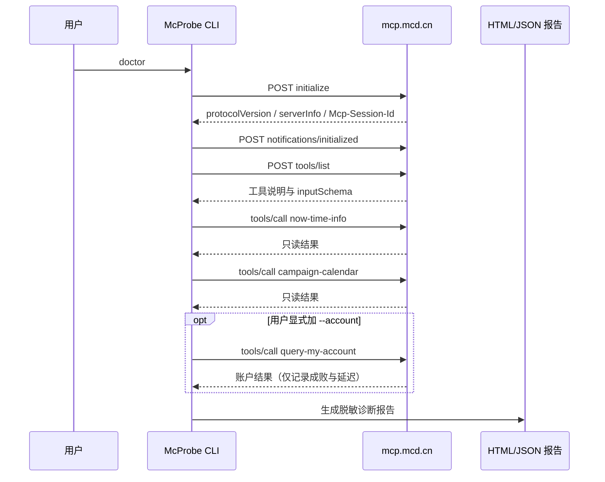

# 麦当劳中国 MCP 接入说明

## 1. 实际使用的服务

| 项目 | 值 |
|---|---|
| MCP Server | McDonald's China MCP |
| 接入地址 | `https://mcp.mcd.cn` |
| 传输协议 | Streamable HTTP |
| 鉴权方式 | `Authorization: Bearer <MCD_MCP_TOKEN>` |
| Token 获取 | <https://open.mcd.cn/mcp> 手机号登录 → 控制台 → 激活 |
| 客户端协议版本 | `2025-06-18`，失败时回退到 `2025-03-26` 和 `2024-11-05` |
| 隐私模式 | 默认开启 |

McProbe 用 Python 标准库直接实现最小 Streamable HTTP 客户端，不依赖第三方 MCP SDK。

## 2. 真实调用链



### 2.1 初始化

请求方法：

```text
initialize
```

用途：

- 验证服务可达；
- 协商 MCP 协议版本；
- 读取 `serverInfo` 与 capabilities；
- 接收可选的 `Mcp-Session-Id`。

### 2.2 完成初始化通知

请求方法：

```text
notifications/initialized
```

用途：按 MCP 标准完成握手，确保后续 `tools/list` 和 `tools/call` 处于有效会话中。

### 2.3 工具发现

请求方法：

```text
tools/list
```

用途：

- 建立当前工具契约；
- 对比 35 项基线；
- 记录工具 `inputSchema` 的稳定指纹。

### 2.4 只读冒烟

默认调用：

| Tool | 业务价值 | McProbe 使用方式 |
|---|---|---|
| `now-time-info` | 验证基础只读工具是否真正可执行 | 无参数调用，记录成败与延迟 |
| `campaign-calendar` | 验证活动数据读取路径 | 无参数调用，报告仅保留短预览 |
| `query-my-account` | 验证会员账户权限 | 仅在 `--account` 时调用；不展示余额 |

## 3. 工具契约

2026-10-22 的实时公开资料和社区实测显示，`tools/list` 返回 35 项工具。McProbe 使用以下基线：

| 领域 | 工具 |
|---|---|
| 营养 | `list-nutrition-foods` |
| 地址与门店 | `delivery-query-addresses`、`delivery-create-address`、`delivery-query-stores`、`query-nearby-stores` |
| 菜单与计价 | `query-meals`、`query-meal-detail`、`calculate-price` |
| 点餐订单 | `create-order`、`cancel-order`、`query-order`、`order-list` |
| 活动与优惠券 | `campaign-calendar`、`available-coupons`、`auto-bind-coupons`、`query-my-coupons`、`query-store-coupons` |
| 会员账户 | `query-my-account` |
| 积分与商城 | `mall-points-products`、`mall-product-detail`、`mall-create-order`、`mall-order-list`、`mall-order-detail` |
| 时间 | `now-time-info` |
| 抽奖与奖品 | `query-lottery-info`、`draw-lottery`、`query-my-prizes` |
| 派对预订 | `query-party-city`、`query-party-store`、`query-party-store-date`、`query-party-store-session`、`party-order-create` |
| 团餐辅助 | `query-meal-assistance` |
| 实测额外工具 | `query-promotions`、`query-survey-coupon` |

> 实测提醒：官方接口文档中曾出现 `query-partystore-date` / `query-partystore-session`，当前 `tools/list` 实际返回 `query-party-store-date` / `query-party-store-session`。McProbe 以实时契约为准，并把这类命名漂移直接暴露出来。

官方 README 在本次开发时列出 33 项；社区 `M-China/mcd-mcp-server` Issue #16 记录了实时 `tools/list` 多出的 `query-promotions` 和 `query-survey-coupon`。McProbe 把这个差异做成可审计基线，而不是硬编码“官方文档永远正确”。

## 4. 写入隔离

McProbe 将以下 7 项标记为可写风险，只检查工具是否存在，**从不调用**：

```text
delivery-create-address
create-order
cancel-order
auto-bind-coupons
mall-create-order
draw-lottery
party-order-create
```

以下个人数据工具即使出现在 `tools/list` 中，也不会把原始结果写进报告：

```text
delivery-query-addresses
query-store-coupons
query-my-coupons
query-my-account
query-order
order-list
query-my-prizes
mall-order-list
mall-order-detail
```

## 5. 错误诊断映射

| 现象 | 诊断 | 建议动作 |
|---|---|---|
| HTTP 401/403 | Token 无效、过期或无权限 | 重新登录、激活并替换 Token |
| HTTP 404 | 接入地址或客户端传输方式不对 | 使用 `https://mcp.mcd.cn` 和 Streamable HTTP |
| HTTP 429 | 超过每分钟 600 次请求限制 | 等待后重试，避免并发探测 |
| 连接超时 | DNS、TLS、代理或防火墙 | 检查网络、代理规则与系统时间 |
| 初始化版本失败 | 客户端协议不兼容 | McProbe 自动回退旧版本；仍失败则升级客户端 |
| 工具比基线少 | 服务契约变化或权限裁剪 | 查看缺失工具，先恢复必需只读能力 |
| 工具比基线多 | 服务发布了新能力 | WARN，不视为故障；更新基线后再运行 |
| 单项调用失败 | 业务权限、参数或服务状态 | 保留 JSON-RPC 错误码，按工具排查 |

## 6. 业务价值

McProbe 面向的不是“再推荐一个套餐”，而是 MCP 项目开发中最耗时的“到底哪里坏了”：

- 把模糊错误变成本次可核验的证据；
- 给 Agent Skill 开发者一个可复用的接入前 smoke test；
- 用 schema 指纹发现服务升级引起的静默漂移；
- 让用户在授权账户数据前先确认连接链路正常；
- 默认拒绝写入，降低“诊断工具误下单”的风险；
- 生成能附到 Issue、PR 或聊天里的统一报告。

## 7. 合规边界

- 仅在中国大陆使用，遵循麦当劳 MCP 服务规则。
- 不绕过登录、验证码、支付、风控或业务限制。
- 不自动下单，不自动领券，不自动抽奖。
- 不将 Token 写入 repo、报告、日志或命令输出。
- 不把模拟数据描述成实时数据。
- McProbe 是参赛者开发的非官方诊断工具。

## 8. 验证记录

截至 2026-10-22，本仓库已完成的验证：

| 验证项 | 结果 |
|---|---|
| Python 编译检查 | 通过 |
| 10 项自动测试 | 通过 |
| 本地假服务端完整握手，含 initialize / initialized / tools/list / tools/call | 通过 |
| 离线报告和 schema 指纹 | 通过 |
| 手机宽度 390 px 与桌面宽度 1200 px 渲染 | 通过，无横向溢出 |
| 连接真实 `https://mcp.mcd.cn` 并发送无效测试 Token | 正确返回 HTTP 401，报告不泄露 Token |
| 使用真实有效 Token 完成 35 项工具的实时体检 | 通过：35/35，协议 `2025-06-18`，写入调用 0 次 |

“无效 Token 测试”只验证网络可达与错误映射，不计作实时健康通过。真实结果以参赛者本人运行生成的 live JSON 为准。
