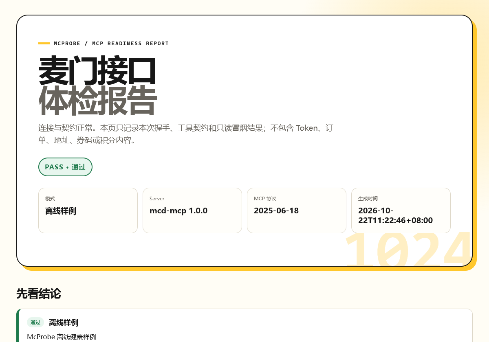

# McProbe · 麦门接口体检站

> 给麦当劳中国 MCP 做一次 30 秒体检：先判断 Token、网络、协议、工具契约和业务权限到底卡在哪，再决定下一步。



McProbe 是一个**隐私优先、默认只读**的诊断 Skill / CLI。它连接麦当劳中国官方 MCP Server，完成标准初始化握手、读取工具清单，并调用少量关键只读工具；最后生成一份可分享、可打印的 HTML 报告和一份机器可读的 JSON。

本项目参加 **2026 麦当劳程序员创意开发大赛（1024 程序员节）**，是参赛者独立开发的非官方工具。

## 为什么做这个

MCP 接入失败时，用户通常只会看到一句“工具不可用”或“连接失败”。但真实原因可能完全不同：

| 实际原因 | 常见表象 | McProbe 怎么区分 |
|---|---|---|
| Token 没配、失效或无权限 | 客户端显示未连接 | 检查环境变量，捕获 HTTP 401/403 |
| DNS、代理、TLS 或防火墙 | 所有工具都超时 | 单独记录连接错误和延迟 |
| 客户端不支持 Streamable HTTP | 初始化失败或工具为空 | 执行标准 initialize 握手 |
| 服务更新导致工具改名 | 某个 Skill 突然失效 | 对比 35 项工具基线并计算 schema 指纹 |
| 业务权限或参数问题 | tools/list 正常，单项调用报错 | 运行独立只读探针并保留错误码 |
| 用户误以为“已下单” | 工具调用状态不透明 | 默认隔离 7 项可写工具，报告写入次数为 0 |

它不替用户再做一个点餐助手，而是给整个 MCP 生态补一层可观测性和故障定位。

## 能做什么

- 验证 MCP Server 的 Streamable HTTP 初始化握手。
- 对比当前 35 项工具与经过审计的基线。
- 计算工具 input schema 指纹，快速看出接口定义是否变化。
- 调用 `now-time-info` 和 `campaign-calendar` 做只读冒烟。
- 可选调用 `query-my-account`，但只记录成功/失败与延迟，**不展示账户内容**。
- 自动把 401、403、404、429、超时、协议不兼容和 JSON-RPC 错误翻译成下一步动作。
- 生成桌面/手机都适配、可直接打印的 HTML 报告。
- 输出稳定的 JSON，可用于 CI、Issue 复现和版本对比。
- 默认不调用任何写工具：不下单、不取消、不领券、不抽奖、不兑换、不修改地址。

## 30 秒离线体验

不需要 Token，不会连接网络：

```powershell
git clone https://github.com/anjiaming8/mcprobe.git
cd mcprobe
$env:PYTHONIOENCODING = "utf-8"
python -m mcprobe doctor --demo --out demo/report.html --json-out demo/report.json
```

直接查看仓库里的示例报告：

- [HTML 体检报告](demo/report.html)
- [JSON 诊断结果](demo/report.json)

离线样例只验证诊断逻辑，**不代表当前麦当劳服务状态**。

## 真实连接

### 1. 申请 Token

1. 打开 <https://open.mcd.cn/mcp>。
2. 用本人手机号登录。
3. 进入“控制台”，点击“激活”。
4. 阅读并同意服务协议，复制 MCP Token。

Token 代表你的麦当劳会员身份，不要发到公开仓库、聊天截图或 Issue。

### 2. 只在本机设置环境变量

PowerShell：

```powershell
$env:MCD_MCP_TOKEN = "你的 Token"
$env:PYTHONIOENCODING = "utf-8"
```

不要使用 `setx MCD_MCP_TOKEN ...` 把 Token 永久写进系统环境变量，除非你明确知道自己需要这样做。

### 3. 运行体检

```powershell
python -m mcprobe doctor `
  --out reports/mcprobe-live.html `
  --json-out reports/mcprobe-live.json
```

需要额外检查账户读取权限时：

```powershell
python -m mcprobe doctor --account `
  --out reports/mcprobe-account.html `
  --json-out reports/mcprobe-account.json
```

`--account` 也只会记录 `query-my-account` 的成败和延迟，不会把积分余额写进报告。

## 退出码

| 退出码 | 含义 | 建议 |
|---:|---|---|
| `0` | PASS | 连接、协议、工具契约和只读探针正常 |
| `1` | WARN | 能连上，但出现新增/变更工具或非关键告警 |
| `2` | FAIL | Token、网络、协议、工具缺失或只读调用失败 |

## 作为 Agent Skill 使用

把 `skill/` 目录复制到支持 Agent Skills 的目录，例如：

```powershell
Copy-Item -Recurse .\skill "$env:USERPROFILE\.codex\skills\mcprobe"
```

然后对 AI 说：

```text
帮我给麦当劳 MCP 做一次体检，并把报告给我。
```

Skill 会先确认 Token 是通过环境变量提供，不会要求你把 Token 贴在对话里。

## 项目结构

```text
mcprobe/
├── mcprobe/                 # Python 标准库实现的 CLI 和 MCP 客户端
├── skill/                   # 可安装的 Agent Skill
├── tests/                   # 离线与假服务端回归测试
├── demo/                    # 可公开查看的离线报告
├── MCP_INTEGRATION.md       # 实际 MCP 调用链、工具清单、边界
├── mcp-config.example.json  # 仅环境变量占位符
└── CONTEST_DECLARATION.md   # 官方参赛声明原文
```

## 开发与测试

只要求 Python 3.10+，不使用第三方运行时依赖：

```powershell
python -m compileall -q mcprobe tests
python -m unittest discover -s tests -v
```

测试覆盖：

- Streamable HTTP initialize → initialized → tools/list → tools/call 完整链路；
- SSE 多行事件解析；
- 35 项工具契约；
- 工具缺失与新增提示；
- 账户数据隐藏；
- 写工具只检查存在性、不执行；
- HTML 输出与内容转义；
- Windows 下 CLI 生成 HTML + JSON。

## 已知边界

- 目前的工具基线是 2026-10-22 的 35 项快照；官方新增工具时，报告会说“WARN”，不会盲目把它当故障。
- 实时体检只能证明**本次请求**成功，不能保证服务永久可用。
- McProbe 诊断 MCP 连接和工具契约，不评价餐品质量，也不构成营养或医疗建议。
- 需要 `campaign-calendar` 或 `query-my-account` 的账号权限；未开通时报告会明确失败，不做猜测。

## 目标用户

- 正在接入麦当劳 MCP 的 Agent / Skill 开发者。
- WorkBuddy、Cursor、Cherry Studio、Codex 等 MCP 宿主用户。
- 需要排查“为什么菜单或优惠券查不到”的普通用户。
- 希望给 MCP 项目增加 smoke test 和 schema 漂移检查的开源作者。

## 安全与合规

- 仓库不包含真实 Token、手机号、地址、订单、券码或积分余额。
- MCP 配置示例只使用 `${MCD_MCP_TOKEN}` 占位符。
- 默认隐私模式不保存个人账户原始返回。
- 不连接未声明站点，不执行远端命令，不修改用户文件。
- McProbe 是参赛作品，非麦当劳官方产品；餐品、价格、活动与供应状态以麦当劳官方渠道为准。

## License

[MIT](LICENSE)
